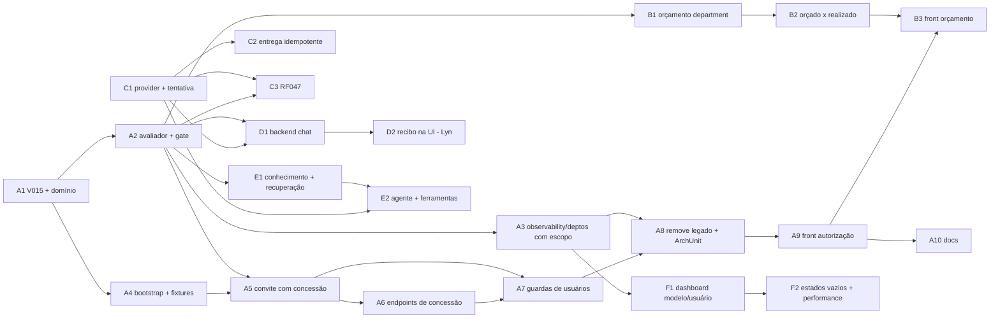

# Sprint 3 — Plano de execução (SPI)

- **Período:** 06/10/2026 a **23/10/2026**. Restam 5 dias úteis a partir de 19/10.
- **Origem:** `docs/review/VERIFICACAO_FASE0.md` (verificação do plano N01–N05 contra o código) e
  as decisões do responsável de 18/10/2026.
- **Quem implementa:** outro modelo ou agente, seguindo `HANDOFF.md`. Este diretório é a fonte de
  verdade de **o que** fazer. Os ADRs e `ai/*.md` são a fonte de **como** a arquitetura funciona.

---

## 1. Decisões já tomadas (18/10/2026)

| # | Decisão |
|---|---|
| 1 | Quem registra o tenant vira `TENANT_ADMIN` na mesma transação (ADR-37). |
| 2 | `TENANT_ADMIN` separado de EXECUTIVE (ADR-36). |
| 3 | `POST /api/v1/usuarios` é removido; a entrada de usuários é só por convite. |
| 4 | Escopo fixo por papel (ADR-36). |
| 5 | Não-admin só concede COLLABORATOR/LEADER no próprio escopo; MANAGER e acima só o `TENANT_ADMIN`. |
| 6 | Convite com token em hash, revalidação no aceite, pendentes antigos revogados na V015. |
| 7 | `DROP TABLE user_permission` no release **seguinte** (não nesta sprint). |
| 9 | Outro tenant → 404; mesmo tenant fora do escopo → 403. |
| 10 | Filtro do dashboard fora do escopo → 403. |
| 15 | **Nada é cortado:** orçamento, provider, chat e agente/RAG ficam na Sprint 3, para a apresentação. |

## 2. Aprovações

**Concedidas em 18/10/2026:**
- ADRs 35 (opção A), 36, 37, 38 e 39 — **ACCEPTED**;
- estouro dos tetos: 12 endpoints novos e 5 ADRs novos.

**Ainda pendentes:**

| Pendência | Bloqueia | Recomendação |
|---|---|---|
| **Decisão 11** — provider concreto da demo | Só a configuração do provider real da demo. C1, C2, C3, D1 e E2 seguem com o adaptador `STUB`. | Endpoint compatível com OpenAI (OpenAI, Groq ou Ollama local); chave em variável de ambiente, fora do repo. |
| Decisões 12, 13 e 14 (retentativa e retenção, custo de erro, RF047 com negadas) | Nada: C2 e C3 usam os valores padrão da SPEC-03 | Manter os valores padrão; retenção fica para depois. |
| Chaves Jira das tarefas novas (§6) | Nomes de branch e commit | Criar no Jira e informar ao implementador. |
| V020 (índice de performance) | Só a F2, e só se houver evidência | Avaliar quando a F2 trouxer os planos de execução. |

## 3. Ondas, ordem e dependências

### Trilhas que podem correr em paralelo

Para não haver conflito, cada trilha fica em módulos diferentes.

| Trilha | Tarefas (em ordem) | Módulos | Pode começar |
|---|---|---|---|
| T1 — IAM | A1 → A2 → A4 → A5 → A6 → A7 → A8 | `iam`, `sharedkernel` | já (após ADR-36/37) |
| T2 — IA | C1 → C2 → C3 | `aigateway`, `observability` (listener e `RecordUsage`) | já (com o `STUB`) |
| T3 — Escopo e analytics | A3 → F1 → F2 | `observability`, `department` (web) | após A2 |
| T4 — Orçamento | B1 → B2 | `department`, `observability` | após A2 |
| T5 — Chat | D1 | `chat` | após A2 + C1 |
| T6 — Agente | E1 → E2 | `agentpolicies` | após A2 (+ C1 para E2) + ADR-35 |
| T7 — Front | A9 → B3 (+ D2 com a Lyn) | `src/main/resources/static` | após A8 / B2 |
| Fechamento | A10 | `ai/`, `docs/` | por último |

**Conflitos a evitar:**
- T3 e T4 tocam o `observability`: A3 → B2, nessa ordem, ou em branches com rebase.
- T2 (C2) altera o listener e o `RecordUsage` do `observability`, que T3/T4 não tocam.
- **Release:** A1–A8 vão juntas para `main`. Corrigir N01 sem N03 transforma falha de
  disponibilidade em falha de segurança.

## 4. Migrations (numeração reservada — não reutilizar)

| Versão | Tarefa | Módulo |
|---|---|---|
| V015 | A1 | `iam` |
| V016 | B1 | `department` |
| V017 | C1 | `aigateway` |
| V018 | D1 | `chat` |
| V019 | E1 | `agentpolicies` |
| V020 | F2 (só se houver evidência e aprovação) | `observability` |
| V021+ | release seguinte: `DROP TABLE user_permission` | `iam` |

Se duas trilhas rodarem em paralelo, cada uma usa **só** o número reservado para ela.

## 5. Orçamento de complexidade (plano × realizado)

| Dimensão | Teto do plano | Nesta sprint | Situação |
|---|---|---|---|
| Dependências novas (Maven/npm) | 0 | 0 (opção A do ADR-35) | ok |
| Infra nova (broker, Redis, vetor) | 0 | 0 | ok |
| Eventos de domínio novos | 0 | 0 | ok |
| Migrations | ≤ 5 | 5 (V015–V019), +1 opcional | ok; V020 pede aprovação |
| ADRs novos | ≤ 4 | 5 (35, 36, 37, 38, 39) | **aprovar** |
| Endpoints novos | ≤ 6 | 12 | **aprovar** |

Os 12 endpoints novos:
- autorização (3): `GET /papeis`, `POST /usuarios/{id}/concessoes`,
  `DELETE /usuarios/{id}/concessoes/{id}`;
- orçamento (3): `PUT /departamentos/{id}/orcamentos/{mes}`, `GET /departamentos/{id}/orcamentos`,
  `GET /observability/orcamentos`;
- tentativas (1): `GET /ai-gateway/tentativas`;
- chat (4);
- agente (1).

F1 estende endpoints existentes, sem criar novos.

## 6. Mapa Jira → tarefas

| Jira | Ação no Jira | Tarefa |
|---|---|---|
| SPI-42, SPI-43 | Redefinir (papéis de sistema com escopo; V015) | A1, A2 |
| SPI-44 | Manter; fecha com A8 | A8 |
| SPI-46 | Redefinir (convite com concessão) | A5 |
| SPI-47 | Redefinir (endpoints de concessão) | A6 |
| SPI-48 | Trazer para a sprint (backend em A6, tela em A9) | A6, A9 |
| SPI-50 | Manter fechada; AZ01–AZ20 nas tarefas A | — |
| SPI-51 | Trazer para a sprint | A10 |
| **Nova** "Bootstrap do primeiro admin (N01)" | Criar | A4 |
| **Nova** "Guardas de elevação na gestão de usuários (N03)" | Criar | A7 |
| SPI-54, 77, 78, 83, 85, 86, 90 | **Fechar** (já implementadas — VERIFICACAO 1C) | — |
| SPI-73 | Manter aberta; fecha com A3 (hoje está sem escopo) | A3 |
| SPI-94 / SPI-112 | Manter 94; fechar 112 como duplicata | A3 |
| SPI-96 | Redefinir para DB01–DB04 | A3 |
| SPI-74 | Manter fechada | — |
| **Nova** "Tentativas duráveis de IA (N05/RF047)" | Criar | C1, C2, C3 |
| SPI-127 | Redefinir: "cliente de provider via HTTP, sem SDK" | C1 |
| SPI-97–100 / SPI-113–116 | Manter 97–100; fechar 113–116 como duplicatas | F1 |
| SPI-95, SPI-101 / SPI-117 | Manter 95 e 101; fechar 117 | F2 (+ A9) |
| SPI-118, 119, 122, 125 | Manter | B1 |
| SPI-120, 123, 126 | Manter | B2 |
| SPI-121, 124 | Manter | B3 |
| **Nova** "Backend do chat corporativo" | Criar | D1 |
| SPI-134, SPI-136 | Manter (Lyn) | D2 |
| SPI-128, 129 | Redefinir (busca nativa, sem pgvector e sem embeddings) — se ADR-35 = A | E1 |
| SPI-130 | Manter | E1, E2 |
| SPI-132, SPI-135 | Manter | E2 |

## 7. Roteiro da apresentação (o que precisa funcionar em 23/10)

1. Registrar a empresa: quem registra vira administrador (A4).
2. Criar departamentos e convidar um gestor e um colaborador. O convite carrega o papel (A5, A9).
3. Cadastrar o provider e o modelo e definir a política de modelos por departamento (C1 + catálogo
   existente).
4. O colaborador conversa no chat e cada resposta mostra o recibo: modelo, tokens, custo e latência
   (D1, D2).
5. O colaborador pergunta ao agente de políticas; a resposta cita as fontes. Um usuário de outro
   departamento não recebe a política restrita (E1, E2).
6. O gestor vê o dashboard só do seu departamento; o colaborador, só o próprio uso; o admin, tudo
   (A3, F1).
7. O orçamento do mês mostra alerta a 80% e excedido a 100%, sem bloquear (B1–B3).
8. Segurança ao vivo: o gestor tenta se promover ou ver outro departamento e recebe 403 (A7, A3).

**Prioridade se o tempo apertar** (decisão do responsável, não do implementador):
- os passos 1, 2, 4, 6 e 8 dependem de A + C1 + D1;
- o passo 5 depende de E;
- o passo 7 depende de B.

## 8. Arquivos deste diretório

- `HANDOFF.md`: protocolo para o modelo implementador. Ler primeiro.
- `SPEC-01-autorizacao.md`, `SPEC-02-orcamento.md`, `SPEC-03-execucao-ia.md`, `SPEC-04-chat.md`,
  `SPEC-05-agente-politicas.md`: especificações compartilhadas.
- `TASK-S3-*.md`: um pacote por tarefa (PR).
