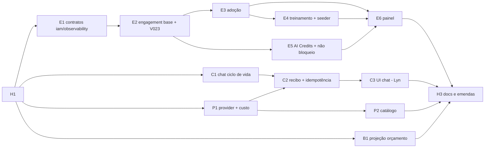

# Sprint 4 — Plano de execução (SPI)

- **Período (Jira):** 26/10/2026 a 06/11/2026, cerca de 9 dias úteis a partir de 27/10.
- **Base do código:** `main` @ `a046384`, com a Sprint 3 integrada. Estado detalhado em
  `docs/review/ESTADO_POS_SPRINT3.md`.
- **Quem implementa:** outro modelo, seguindo o `HANDOFF.md` deste diretório.
- **Fontes de verdade:** este diretório define **o que** fazer; ADRs e `ai/*.md` definem **como** a
  arquitetura funciona.

---

## 1. Ponto de partida (resumo)

**Entregue na Sprint 3 e integrado na `main`:**
- autorização por concessão (A1–A10);
- orçamento e alerta;
- tentativas duráveis e adaptadores de provider (STUB e compatível com OpenAI);
- chat privado com recibo;
- agente de políticas com busca nativa;
- dashboard por modelo e usuário;
- front do chat (SPI-136).

Fora do plano, também entraram:
- **V020:** vínculos com identidades legadas;
- **V021:** `TENANT_ADMIN` sem leitura analítica;
- sessão por cookie no BFF (emendas ao ADR-26/30).

**Pendente para a Sprint 4:**

| Item | Situação |
|---|---|
| Engajamento | Módulo vazio |
| Provider real da demo | Não escolhido |
| Custo com preço nulo | Contado como zero (bug) |
| Ciclo de vida e recibo durável do chat | Faltam |
| Projeção de orçamento | Não existe |
| Tela do catálogo | Chama rotas inexistentes |
| `user_permission` | Ainda existe |
| `compose.yaml` | Sem `JWT_SECRET` |
| Testes do front | Fora do CI |
| Linha de base verde integral | Não comprovada |

## 2. Decisões (recomendação em negrito)

> **Registro em 28/10/2026:**
> - **Decididas pela recomendação:** S4-D2 a S4-D7 e S4-D9 a S4-D13. Os ADRs 40, 41 e 42 estão
>   ACCEPTED.
> - **Abertas:**
>   - **S4-D1** (provider da demo): o responsável informa depois; não bloqueia código;
>   - **S4-D8 = ADIAR** (28/10): `user_permission` continua no schema. A TASK-S4-H2 sai da Sprint 4 e a V024 não é usada.

| # | Decisão | Opções | Recomendação | Bloqueia |
|---|---|---|---|---|
| S4-D1 | Provider real da demo (antiga decisão 11) | OpenAI · Groq · Azure OpenAI · Ollama local | **Qualquer um compatível com OpenAI; Ollama se a demo for offline**. O código não muda | só o roteiro manual da P1 |
| S4-D2 | Fontes dos indicadores de engajamento | (a) operacional + histórico, separados · (b) só operacional · (c) só histórico | **(a)** — ADR-40 | E2–E6 |
| S4-D3 | Denominador da adoção | (a) elegíveis IAM · (b) usuários licenciados (texto da SPI-143) | **(a)**, com licenças ociosas reportadas à parte | E3 |
| S4-D4 | Parâmetros do AI Credits v1 | U por dias ativos/10 no mês; T = ≥ 1 conclusão; L = licenças utilizadas/aplicáveis; snapshot mensal | **Aceitar `credits-v1`** (ADR-40 §7) | E5 |
| S4-D5 | Lista nominal no cruzamento de treinamento | (a) só para quem tem `USER:READ` no recorte · (b) para todo `USAGE:READ` · (c) nunca | **(a)** | E4 |
| S4-D6 | Projeção de orçamento (SPI-131) | (a) endpoint no `observability` · (b) ferramenta do agente (muda a allowlist) | **(a)**; (b) fica para depois | B1 |
| S4-D7 | Exclusão de conversa | (a) soft delete, conteúdo retido · (b) exclusão física | **(a)**; expurgo é decisão futura (LGPD) | C1 |
| S4-D8 | `DROP TABLE user_permission` (V024) | agora · adiar | **Decidido: adiar** (28/10); a recomendação era "agora" | H2 (fora da sprint) |
| S4-D9 | `compose.yaml` passa a repassar `JWT_SECRET` | sim · não | **Sim** (mudança de config) | parte de H1 |
| S4-D10 | Idioma das rotas novas do engajamento | `/api/v1/engajamento/*` · `/api/v1/adoption/*` (Jira) | **PT**, como `conversas`, `orcamentos`, `usuarios` | E3–E5 |
| S4-D11 | Cota pessoal no chat | (a) sem cota, só o consumo informativo pelo `/metrics/me/*` · (b) criar cota | **(a)** nesta sprint | C3 |
| S4-D12 | Preço obrigatório para AVAILABLE | sim · não | **Sim**, mais a defesa em runtime (INCONCLUSIVE) | P1 |
| S4-D13 | Aceitar os ADRs 40, 41 e 42 | — | **Aceitar** | E, B1, C1/C2 |

## 3. Ondas, ordem e dependências

### Trilhas paralelas (módulos disjuntos)

| Trilha | Tarefas | Módulos | Prioridade para a demo |
|---|---|---|---|
| T1 — Engajamento (crítica) | E1 → E2 → E3 → E4 → E5 → E6 | `iam.api`, `observability.api`, `engagement`, front do dashboard | Alta: épico novo, SPI-143 a 148 |
| T2 — Chat | C1 → C2 → C3 | `chat`, `aigateway.api` | Alta |
| T3 — Gateway | P1 → P2 | `aigateway`, front do catálogo | Média; a demo real depende do S4-D1 |
| T4 — FinOps | B1 | `observability` | Média |
| Partida e fechamento | H1 … H3 | build, `iam`, docs | H1 primeiro, H3 por último |

**Conflitos a evitar:**

| Ponto de contato | Tarefas | Como resolver |
|---|---|---|
| `observability` (`api/` novo × `orcamentos`) | E1 e B1 | Classes diferentes; rebase simples |
| `ModelResolutionQuery` (`aigateway.api`) | C1 e P1 | C1 só adiciona um método |
| Front do dashboard | E6 e B1 | Combinar a ordem |

## 4. Migrations (numeração reservada)

| Versão | Tarefa | Módulo |
|---|---|---|
| V022 | C1 | `chat` (`DELETED`, `deleted_at`, `client_message_id`) |
| V023 | E2 | `engagement` (licenças, treinamentos, snapshots) |
| V024 | — | **não usar nesta sprint** (S4-D8 = adiar); fica reservada para o drop futuro de `user_permission` |
| V025+ | — | livre; pedir antes de usar |

> As SPI-139, 145 e 147 citam V018, V019 e V020. **Essas versões já existem.** Use as desta tabela.

## 5. Orçamento de complexidade

| Dimensão | Nesta sprint |
|---|---|
| Dependências novas (Maven/npm) | **0** (servidor HTTP de teste = JDK `com.sun.net.httpserver`) |
| Infra nova | 0 |
| Eventos novos | 0 |
| Migrations | 2 (V022–V023) |
| ADRs novos | 3 (40, 41, 42 — PROPOSED) |
| Endpoints novos | 9 (lista abaixo) |
| Contratos `api.*` novos ou alterados | `IdentityQuery.eligibleUsers`, `UserContext.name`, `HistoricalIdentityQuery.employeeIds`, `observability.api.UsageActivityQuery`, `ModelResolutionQuery.allowedModels`, `aigateway.api.AttemptReceiptQuery` |

Os 9 endpoints novos:

| Grupo | Endpoints |
|---|---|
| Chat (3) | `GET /conversas/modelos`, `PATCH /conversas/{id}`, `DELETE /conversas/{id}` |
| Catálogo (2) | `GET /ai-gateway/departments/{id}/model-policy`, `PUT /ai-gateway/models/{id}` |
| Projeção (1) | `GET /observability/orcamentos/projecao` |
| Engajamento (3) | `/engajamento/adocao`, `/engajamento/treinamentos/cruzamento`, `/engajamento/creditos` |

Nenhuma permissão nova na matriz: tudo usa `USAGE:READ`, `USER:READ`, `CHAT:*` e `AI_TOOL:MANAGE`,
que já existem.

## 6. Mapa Jira → tarefas

**Tarefas da Sprint 4:**

| Jira | Ação | Tarefa |
|---|---|---|
| SPI-87 | Manter | P2 |
| SPI-102 a 110 | **Fechar como duplicatas** de SPI-118 a 126, já concluídas | — |
| SPI-131 | Redefinir: projeção determinística no observability, não tool do agente | B1 |
| SPI-133 | Redefinir: recibo durável e valores = `UsageRecord` | C2 (+ P1) |
| SPI-137 | Redefinir: ADR-35 já aceito na opção A; registrar as emendas e dependências da Sprint 4 | H3 |
| SPI-138 | Redefinir: o adaptador existe; provar ponta a ponta e corrigir o custo sem preço | P1 |
| SPI-139 | Redefinir: V022 sobre o schema existente; sem tokens e custo em `chat_messages` | C1 |
| SPI-140 | Redefinir: rotas `/api/v1/conversas` (PATCH/DELETE e busca) | C1 |
| SPI-141 | Manter (UI, Lyn) | C3 |
| SPI-142 | Manter | C2 |
| SPI-143 | Manter; denominador = elegíveis; rota PT | E1 + E3 |
| SPI-144 | Manter | E6 |
| SPI-145 | Redefinir: V023 e prefixo `engagement_` | E2 + E4 |
| SPI-146 | Manter | E4 |
| SPI-147 | Redefinir: snapshot na V023 | E5 |
| SPI-148 | Manter | E5 |

**Itens fora da Sprint 4:**

| Jira | Ação | Tarefa |
|---|---|---|
| SPI-128, SPI-130 (ainda "A fazer" na Sprint 3) | **Fechar**: implementadas na E1/E2 da Sprint 3 (`819107d`, `f9119ec`) | — |
| A criar | "Linha de base verde, compose e testes do front no CI" | H1 |
| (não criar agora) | "Remover tabela legada user_permission (V024)", adiada pela S4-D8 | H2, fora da sprint |
| Sprint 3 (ativa) | Encerrar no Jira; todas as tarefas estão concluídas, exceto SPI-128/130 acima | — |

## 7. Roteiro de demonstração ao fim da Sprint 4

1. O **colaborador** conversa; recarrega a página e os recibos continuam lá. Arquiva e exclui
   conversas. O seletor só mostra os modelos permitidos (C1–C3).
2. O **gestor** vê, no dashboard, a adoção de 30 dias do departamento, os quadrantes de treinamento
   e a distribuição de AI Credits, nas duas fontes, sem misturá-las (E3–E6).
3. O **executivo** vê a empresa inteira e a projeção de orçamento com o dia de esgotamento (B1).
4. O **admin** edita preços e a política de modelos na tela do catálogo (P2). Um modelo sem preço
   não pode ser ativado (P1).
5. **Segurança:**
   - o admin não lê conversas;
   - o gestor não vê outro departamento;
   - um colaborador com Credits 0 continua usando IA (C2, E5).
6. Com o S4-D1 decidido: resposta real do provider escolhido, com recibo (P1).

## 8. Arquivos

| Arquivo | Conteúdo |
|---|---|
| `HANDOFF.md` | Protocolo do implementador. Ler primeiro |
| `KICKOFF_PROMPT.md` | Prompts prontos para colar |
| `SPEC-06-engajamento.md`, `SPEC-07-chat-evolucao.md`, `SPEC-08-provider-real-e-catalogo.md`, `SPEC-09-projecao-orcamento.md` | Specs |
| `TASK-S4-*.md` | Um pacote por tarefa |
